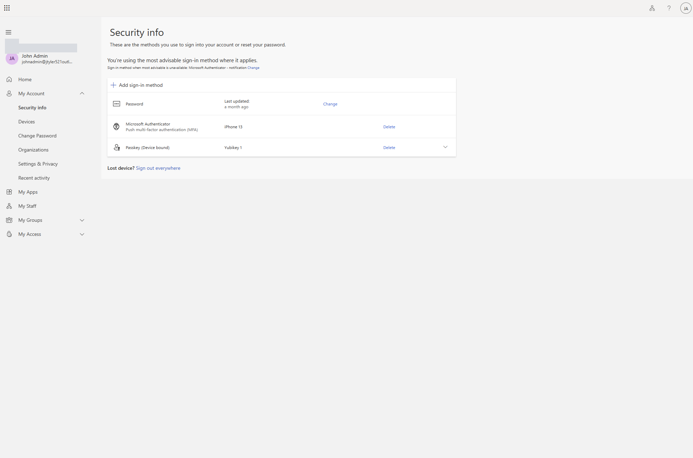
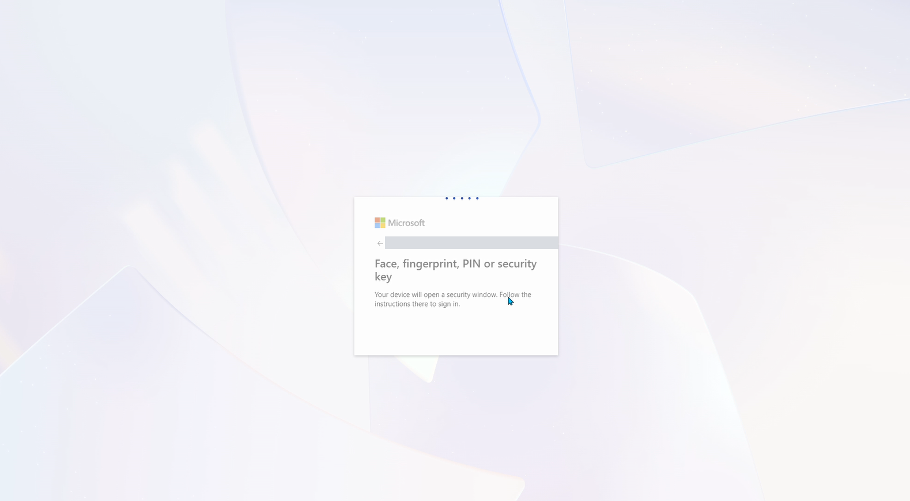
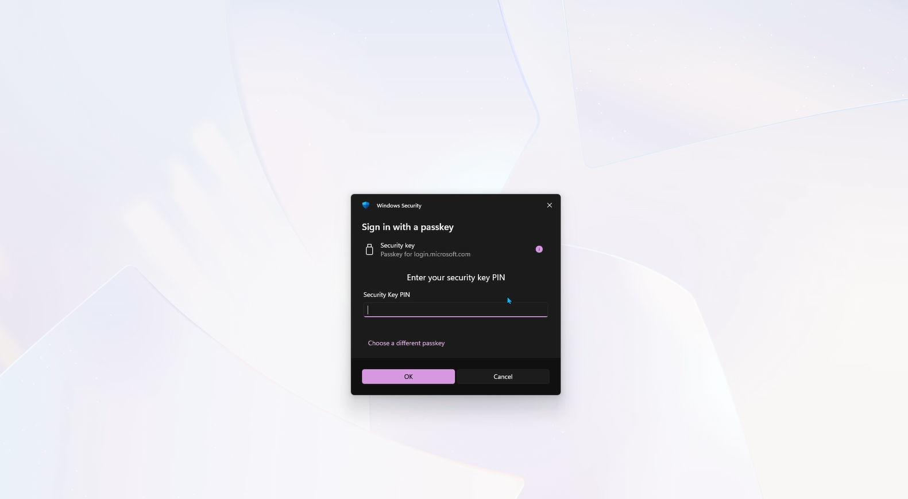
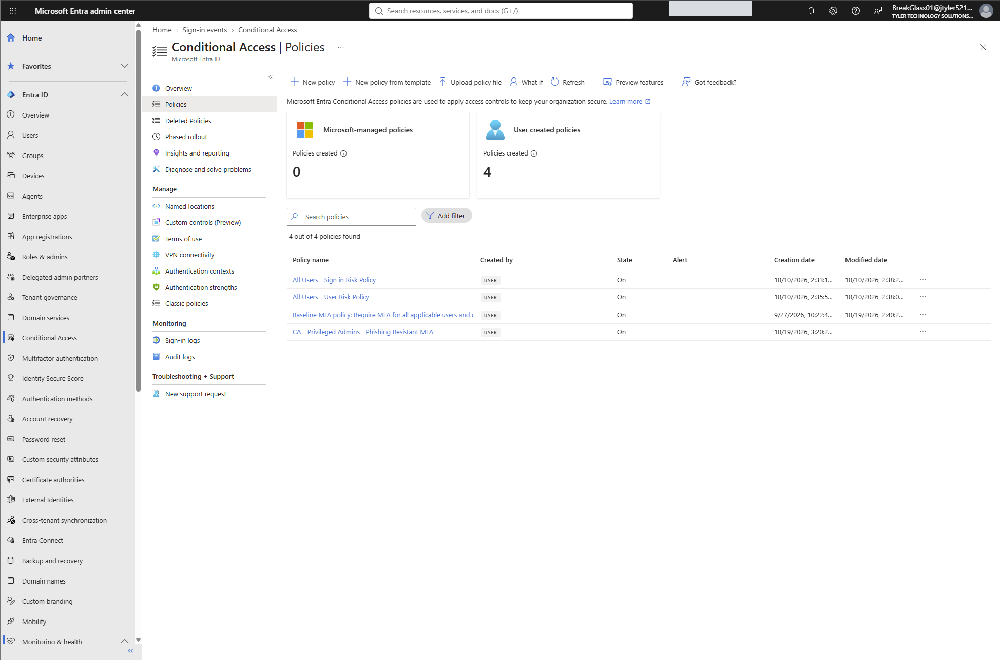
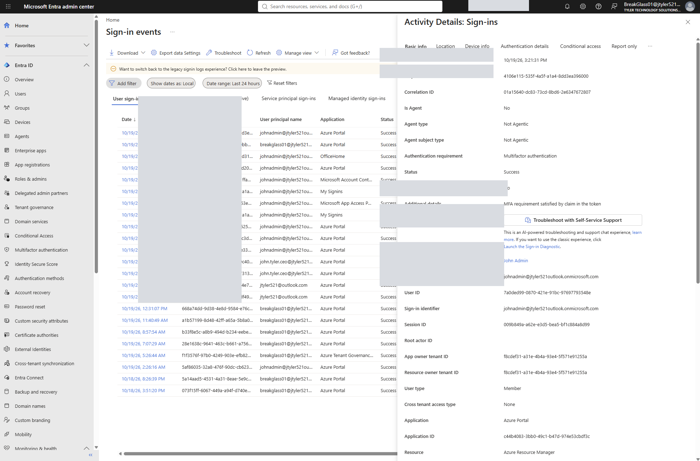
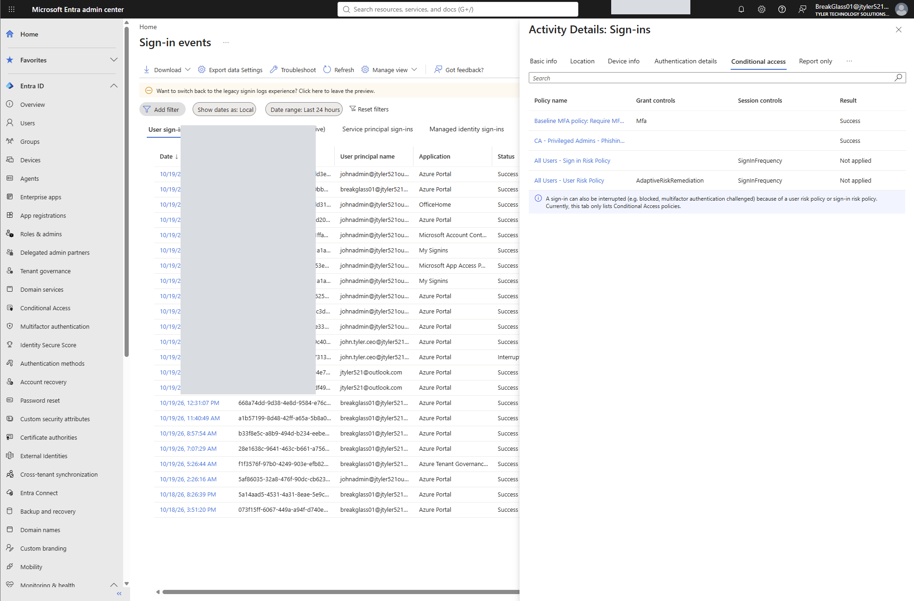

# Microsoft Entra ID — Phishing-Resistant MFA with YubiKey

**Hands-on IAM / Cloud Identity Security Lab** | Microsoft Entra ID · Conditional Access · FIDO2/WebAuthn · YubiKey · Authentication Strengths

## Overview

This project documents the configuration and validation of **phishing-resistant multifactor authentication for privileged Microsoft Entra administrators** using a hardware-backed, device-bound YubiKey passkey.

The lab demonstrates the difference between **registering an authentication method** and **enforcing its use** with Conditional Access. It preserves the baseline MFA requirement while adding a stronger authentication-strength requirement for selected privileged Entra directory roles.

> **Environment:** Personal Microsoft Entra training tenant. This repository documents observed configuration and sign-in evidence; it is not a production deployment or a blanket assertion that every administrator is protected.

## Architecture

| Layer | Design |
| --- | --- |
| Authentication enrollment | Passkey (FIDO2) enabled for the IT-Administrators group |
| Authenticator | Device-bound FIDO2 passkey on a YubiKey hardware security key |
| Baseline policy | MFA required for applicable users and all targeted cloud resources |
| Privileged policy | Phishing-resistant MFA authentication strength for selected privileged directory roles |
| Recovery | Break-glass group excluded from relevant Conditional Access enforcement policies |
| Validation | Microsoft Entra interactive sign-in logs and policy-level results |

**Policy evaluation:** When both baseline and privileged policies apply, their requirements are cumulative. A phishing-resistant FIDO2 authentication can satisfy both; separate MFA prompts are not necessarily required.

## Implementation

1. Enabled **Passkey (FIDO2)** under **Entra ID → Authentication methods → Policies**.
2. Targeted the **IT-Administrators** security group, allowed self-service setup, and configured a **device-bound passkey** profile.
3. Registered a **YubiKey passkey** for the dedicated administrator account and confirmed its presence under **Security info**.
4. Created **CA - Privileged Admins - Phishing Resistant MFA** using privileged **Directory roles**, with **All resources** as the target.
5. Selected **Grant access → Require authentication strength → Phishing-resistant MFA**. This policy does not need a separate basic “Require multifactor authentication” grant control.
6. Excluded the designated emergency-access group and enabled the policy after the lab checks.
7. Reviewed an interactive Azure Portal sign-in and the **Conditional Access** tab to inspect individual policy outcomes.

### Scope limitations

- Directory role targeting does **not** automatically encompass users holding only Azure RBAC roles (such as subscription Owner).
- The built-in **Phishing-resistant MFA** strength supports approved phishing-resistant methods beyond YubiKey.
- A registered security key is evidence of enrollment, not proof of its use on every subsequent sign-in.
- Emergency-access availability needs separate independent testing; policy exclusion alone is not proof of recovery readiness.

## Evidence gallery

### 1. Device-bound passkey enrolled



The administrator's Security info page shows a device-bound passkey alongside other registered methods.

### 2. Entra requests a passkey



An authentication attempt invokes the platform security-key/passkey flow.

### 3. Windows Security prompts for hardware key PIN



Windows Security displays the PIN challenge for the FIDO2 security key; no PIN is exposed in the screenshot.

### 4. Enabled Conditional Access policy inventory



The tenant shows four enabled user-created policies: baseline MFA, privileged phishing-resistant MFA, sign-in risk, and user risk.

### 5. Successful Azure sign-in



The inspected Azure Portal sign-in is marked **Success** with an MFA authentication requirement. Its Basic info states **“MFA requirement satisfied by claim in the token.”** This statement alone does not identify the underlying authentication method for the event.

### 6. Both Conditional Access MFA policies succeeded



The selected sign-in shows **Success** for both the baseline MFA policy and **CA - Privileged Admins - Phishing Resistant MFA**. The sign-in risk and user risk policies show **Not applied** for this event.

## Validation checklist

- [x] FIDO2 passkey registered on the dedicated administrator account
- [x] Privileged phishing-resistant MFA policy enabled
- [x] Baseline MFA policy enabled
- [x] Successful Azure Portal sign-in recorded
- [x] Both relevant Conditional Access policies show **Success** on the inspected sign-in
- [ ] Capture **Authentication details** explicitly identifying the FIDO2/security-key method in the tested sign-in event
- [ ] Independently validate break-glass membership and a successful emergency sign-in
- [ ] Audit all affected admins for phishing-resistant method readiness
- [ ] Review Azure RBAC administrators not encompassed by directory-role scope

## Security considerations

- Keep an appropriately protected, independently tested emergency-access path; exclude emergency accounts only where necessary.
- Register and test supported authentication methods **before** enforcement.
- Test Conditional Access with **What If**, sign-in logs, and a controlled rollout; report-only is a safer default for a general production rollout.
- Use device-bound passkeys and consider attestation / allowed authenticator restrictions where hardware provenance requirements apply.
- Review sign-in **Authentication details** before asserting the exact method used.
- Never publish passwords, security-key PINs, secrets, or unredacted operational identifiers.

## Repository layout

```text
entra-phishing-resistant-mfa-yubikey-lab/
├── README.md
└── screenshots/
    ├── 01-yubikey-fido2-registered.png
    ├── 02-entra-fido2-sign-in-prompt.png
    ├── 03-yubikey-security-key-pin.png
    ├── 04-conditional-access-policy-overview.png
    ├── 05-azure-sign-in-success.png
    └── 06-phishing-resistant-mfa-policy-success.png
```

**Note:** The screenshots folder is populated separately. Until all six PNGs are uploaded with the exact paths above, the gallery will display broken image placeholders.

## Outcome

This lab demonstrates real-world IAM administration: **hardware-backed passkey enrollment, Conditional Access scope design, privileged authentication-strength enforcement, emergency-access planning, and audit-log validation**. The public evidence screenshots have opaque redactions over account identifiers and operational metadata.
